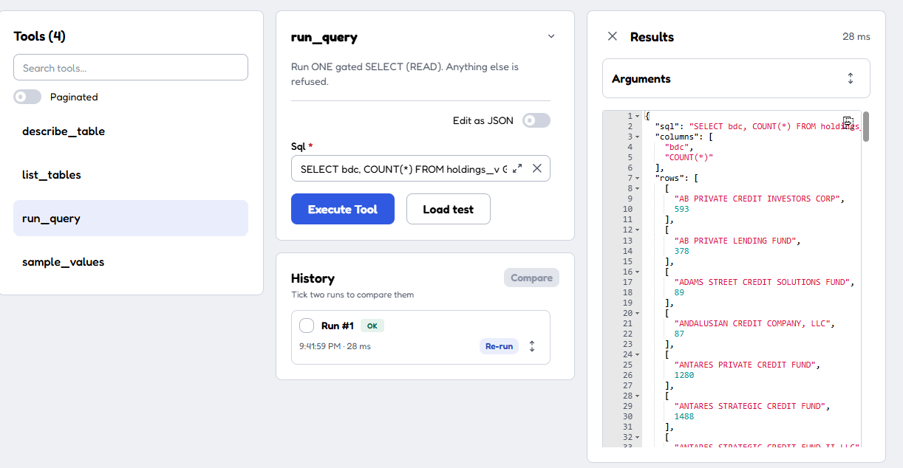
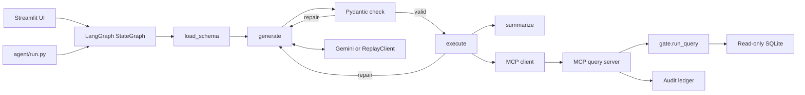

# Ask the Panel

Ask the Panel is a natural-language interface for exploring a BDC holdings
panel. An analyst asks a question; a LangGraph agent writes one read-only
SQLite query, validates it, runs it through an MCP server, and returns the
answer, SQL, result rows, token usage, cost, and execution trace.

Replay is the default model mode. It answers recorded questions from the
committed cache with no API key, network access, or model charges. Record
mode calls Gemini and requires `GEMINI_API_KEY`; keys are never committed.

## Live services

- Streamlit app: <https://cs4b-lantern.streamlit.app>
- Codelab: <https://cs4b-codelab.vercel.app>
- Codelab source: [`docs/codelab.md`](docs/codelab.md)

## Setup (10 minutes)
Run every command from this repository root.
```
python -m venv .venv && source .venv/bin/activate      # Python 3.11 or later
pip install -r requirements.txt
python tests/run_tests.py                               # 26/26 kit tests
python tools/run_notebooks.py                           # 6/6 notebooks, offline
jupyter lab                                             # start with notebooks/00_setup.ipynb
```
Record mode needs a Gemini API key (free, from Google AI Studio): `export GEMINI_API_KEY=...`.
Replay, the tests and grading need no key. Never commit it.

## MCP Inspector



## Architecture



The graph has a capped repair edge that returns validation or database
errors to the model. The agent and Streamlit app reach data only through the
MCP server. The server exposes four read tools and sends every query through
the read-only gate.

## Demo video

**TODO before submission:** add the public demo video URL here.

## Repository layout

- `agent/`: Pydantic contract, LangGraph agent, Gemini replay wrapper, runner,
  and synchronous MCP client.
- `app/`: Streamlit interface.
- `services/mcp/`: audited, read-only MCP query server.
- `sql/holdings_v.sql`: current-schedule analytical view.
- `src/askpanel/`: database, gate, graph nodes, replay, questions, economics,
  and self-check building blocks.
- `questions/` and `outputs/`: ten recorded questions, saved answers, replay
  caches, unit economics, and the failure log.
- `data/real/panel_2p.parquet`: committed real BDC panel.
- `data/panel.sqlite`: generated locally by `tools/build_db.py`; ignored by Git.

## Grader commands

```
python tests/run_tests.py
python tools/build_db.py
pytest -q tests/test_server.py
python agent/run.py --mode replay
PYTHONPATH=src python -m askpanel.check
streamlit run app/streamlit_app.py
```

## Rules that never bend
- The agent and the app reach the data **only** through your MCP server. No `sqlite3` in `agent/` or `app/`.
- The server opens the database read-only, with the authorizer (`gate.connect_ro`).
- Commit `outputs/questions/` and `outputs/cache/`: graders replay your ten questions from them, free and
  offline. Never commit an API key.
- Public SEC data only; every client and person is fictional. Repositories stay private until grades are
  returned.
